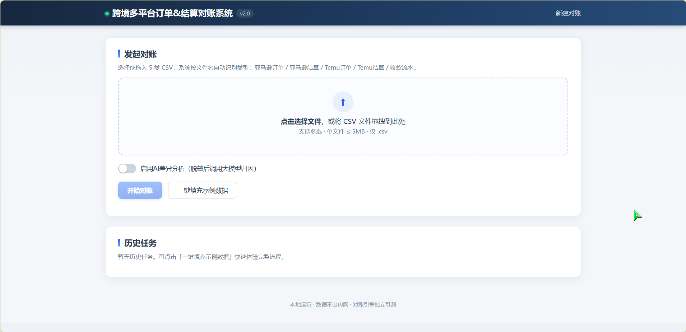
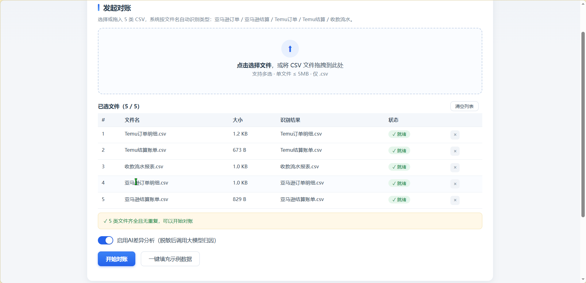
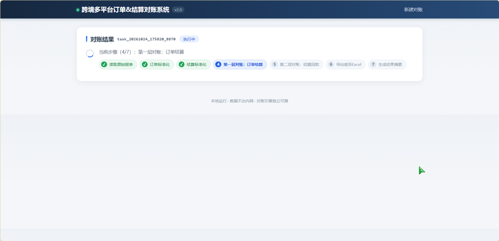
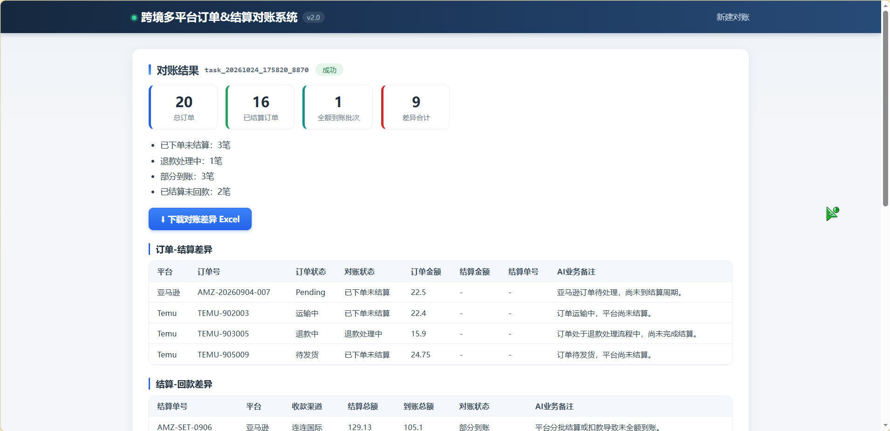
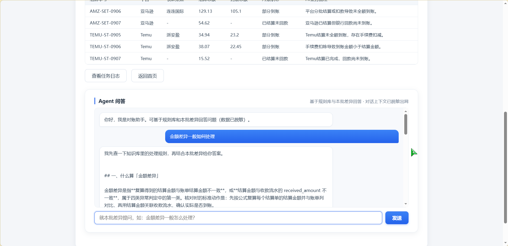
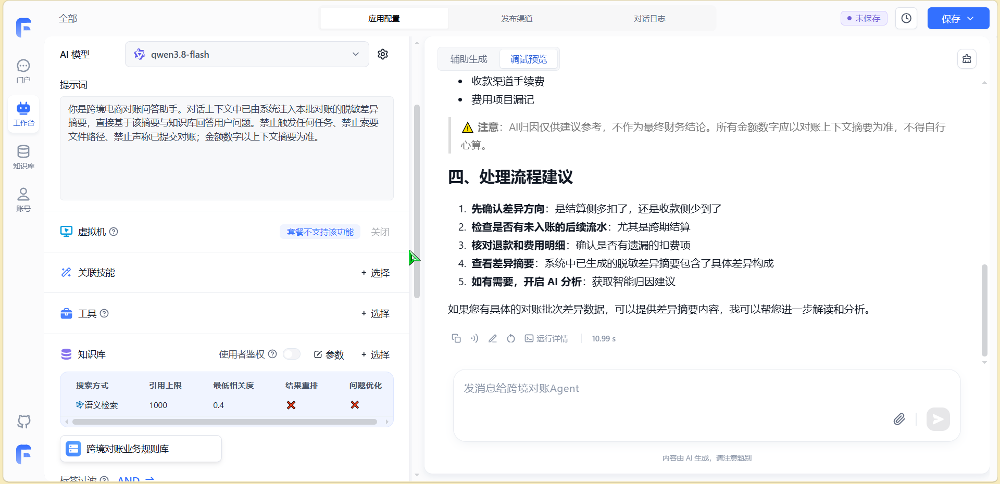
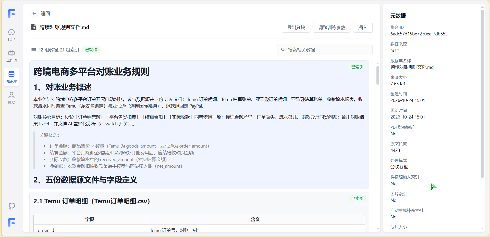
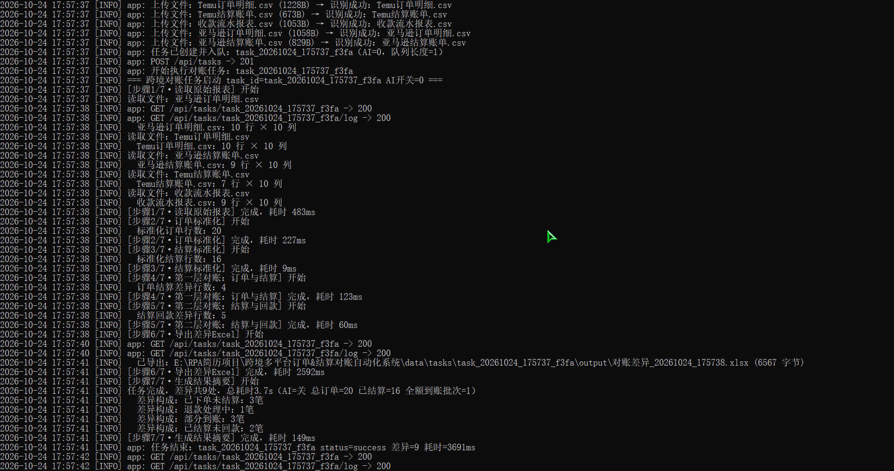

# 跨境多平台订单&结算对账自动化系统

> Flask Web + 规则引擎 + 千问归因 + FastGPT Agent 问答，开箱即用的跨境电商对账工具

## 📖 项目简介
针对跨境电商 Temu、亚马逊平台订单与结算账单人工对账效率低、差异核对繁琐问题，提供一套**打开网页就能用的自动化对账工具**。
上传 5 份后台导出 CSV，系统按文件名自动识别类型，经对账引擎完成「订单 ↔ 平台结算 ↔ 银行回款」双层规则核对，一键产出带时间戳的差异 Excel；可选启用千问 AI 逐条归因备注，可在结果页与 Agent 对话追问差异原因——规则解释基于 RAG 知识库，本批数据经脱敏后注入对话上下文。

本项目为个人技术探索性质的开源成果。仓库内数据均为模拟样例，未涉及任何企业真实生产数据。项目设计为单机本地运行方案，旨在展示RAG与自动化规则在复杂业务场景下的技术可行性，无需依赖企业级服务器环境即可完整复现。

## 🛠 技术栈
- **Web 后端**：Python Flask（上传、任务队列、结果页、下载），waitress 生产级部署
- **规则引擎**：Pandas + OpenPyXL，订单/结算字段标准化、双层对账核比、差异 Excel 输出
- **AI 差异归因（可选）**：阿里云百炼千问（dashscope SDK），脱敏后逐条生成业务备注，带熔断保护
- **Agent 问答（可选）**：FastGPT + RAG 知识库，OpenAPI 服务端代理，注入本批脱敏差异上下文
- **质量保障**：pytest 回归测试（golden 断言、异常输入、降级链、脱敏拦截）
- **数据源**：Temu、亚马逊模拟订单明细、结算账单、收款流水 CSV

## 📁 项目目录结构

跨境多平台订单 & 结算对账自动化系统

├─app.py                  # Flask Web 入口（上传 / 任务队列 / 结果页 / 下载 / 聊天代理）

├─启动_本机.bat            # 双击启动本机模式（python app.py）

├─启动_局域网.bat           # 双击启动局域网模式（waitress 0.0.0.0:8765）

├─engine/                 # 对账引擎（独立包，命令行可单独运行）

│   ├─reconcile.py        #   7 步主流程与结果导出

│   ├─normalize.py        #   亚马逊/Temu 字段标准化

│   ├─checks.py           #   双层对账判定规则

│   ├─attribution.py      #   千问归因 + 失败熔断

│   ├─desensitize.py      #   脱敏（单号掩码 / 金额区间化）

│   └─config.py           #   .env 配置读取与体检

├─web/                    # 网页界面（templates + static）

├─tests/                  # pytest 回归测试（29 个用例）

├─rpa_shadowbot/          # 影刀 RPA 无人值守备选模式（定时/监听文件夹）

├─docs/                   # 使用手册 · SOP手册 · 项目复盘 · 部署手册 · 运维排障 · 数据安全说明

├─后台数据/                # 模拟业务测试 csv 数据（5 份）

├─RAG知识库/               # 对账规则知识源文档（可导入 FastGPT）

├─.env.example            # 配置模板

├─requirements.txt        # 运行依赖

└─README.md

> ⚠️ 重要说明
> 1. API 密钥通过 `.env` 配置（模板 `.env.example`），**不要将明文密钥提交至仓库**；不配置任何密钥时 AI 功能自动隐藏，对账与下载完全可用。
> 2. `data/` 为运行时生成目录（任务数据与日志），已在 `.gitignore` 过滤，不要提交到版本库。
> 3. 代码内样例路径为 Windows 格式，Linux/macOS 使用命令行方式启动并按需调整路径。

## 🔄 整体业务流程
1. 用户打开网页，拖拽上传 5 份后台导出 CSV（或点「一键填充示例数据」），可勾选「启用AI差异分析」；
2. 服务按文件名关键字识别文件类型，落盘至 `data/tasks/{task_id}/raw/`，写入任务状态并进入队列；
3. 后台 worker 串行执行引擎：读取原始报表 → 订单字段标准化 → 结算字段标准化；
4. 第一层对账：订单 ↔ 平台结算 按关联键合并核比，筛出已下单未结算、金额差异、退款异常等；
5. 第二层对账：结算 ↔ 银行回款 按批次汇总核比，筛出已结算未回款、部分到账、回款差异等；
6. （勾选 AI 时）差异行脱敏后逐条调用千问生成 ≤30 字业务备注，连续失败自动熔断降级；
7. 导出 `对账差异_时间戳.xlsx`（双 sheet）与任务摘要，结果页轮询展示统计卡片、差异构成与明细表；
8. （可选）在结果页聊天框追问——服务端注入本批脱敏差异摘要，转发 FastGPT 基于知识库作答。

## ✨ 项目亮点
1. **引擎与 Web 解耦**：`engine/` 不依赖 Flask，网页、命令行、定时任务三种方式共用同一套对账逻辑，可独立测试与复用；
2. **规则引擎 100% 判定**：差异判定全部由确定性规则完成，可复现、可审计，golden 测试锁定样例数据固定产出 9 处差异；
3. **AI 全链路可降级**：无 Key、断网、连续失败熔断——归因与聊天优雅退化，对账与下载永远不受影响；
4. **出网内容强制脱敏**：订单号掩码、金额区间化，测试断言拦截未脱敏 payload，真实业务数据不出内网；
5. **工程化韧性**：任务状态机 + 单线程队列、三层异常捕获（路由/错误页/worker 顶层）、15 分钟看门狗、重启自动恢复、应用/任务双日志体系。

## 🚀 本地运行前置条件
1. Python 3.10+，安装依赖
```bash
pip install -r requirements.txt
```

2.（可选）配置 AI 能力——不配置则对应功能自动隐藏
```cmd
copy .env.example .env
:: 编辑 .env：DASHSCOPE_API_KEY=千问Key            ← AI 差异归因
::           FASTGPT_BASE_URL / API_KEY / APP_ID   ← 结果页 Agent 问答
```

3.（可选，Agent 问答需要）FastGPT 平台创建对话应用并发布获取密钥与应用 ID，导入 `RAG知识库/跨境对账规则文档.md` 至知识库

4. 浏览器：Chrome / Edge 等现代浏览器访问本机页面

## 📝 启动步骤

1. 安装依赖并完成（可选的）`.env` 配置；

2. 启动服务（二选一）：
```cmd
:: 本机模式
python app.py
:: 或双击 启动_本机.bat

:: 局域网共享模式（同事访问 http://本机IP:8765，首次需防火墙放行 8765）
waitress-serve --host=0.0.0.0 --port=8765 app:app
:: 或双击 启动_局域网.bat
```

3. 浏览器打开 `http://127.0.0.1:8765`；

4. 点「一键填充示例数据」（或自行上传 5 份 CSV），按需勾选 AI，点击「开始对账」；

5. 结果页查看差异摘要与明细，下载 `对账差异_时间戳.xlsx`；可选在聊天框追问差异原因；

6.（可选，不走网页的兜底方式）命令行直接执行引擎：
```bash
python -m engine --raw 后台数据 --output output --ai 0
```

7.（开发验证）运行回归测试：
```bash
pytest tests -q
```

8. 深度部署（换机/服务器部署、端口占用排查、防火墙配置、部署后验证清单）见 [docs/部署手册.md](docs/部署手册.md)；故障现象速查见 [docs/运维排障.md](docs/运维排障.md)；数据流向与出网清单见 [docs/数据安全说明.md](docs/数据安全说明.md)；日常操作见 [docs/使用手册.md](docs/使用手册.md)，对账标准作业程序见 [docs/SOP手册.md](docs/SOP手册.md)，设计思路与优化路线见 [docs/项目复盘.md](docs/项目复盘.md)。

## 📸 项目演示截图

> <!-- 1.Web界面启动截图 -->
>
> 
>
> <!-- 2.文件上传，开启AI差异分析截图 -->
>
> 
>
> <!-- 3.执行对账截图 -->
>
> 
>
> <!-- 4.对账结果截图 -->
>
> 
>
> <!-- 5.Agent对话截图 -->
>
> 
>
> <!-- 6.FastGPT Agent 配置截图 -->
>
> 
>
> <!-- 7.FastGPT RAG 知识库截图 -->
>
> 
>
> <!-- 8.运行日志截图 -->
>
> 


## 📌 已知限制与注意事项

1. **项目性质与输出效力**：本项目为个人技术探索性质的开源成果（非企业产品，未对接企业真实环境，未经生产环境验证）；对账结论与 AI 输出仅供参考，**不可直接用于实际财务决策**；
2. 本项目定位单机/局域网工具，未做登录鉴权与高并发处理，任务为单线程队列串行执行；
3. AI 为可选增强且依赖第三方：千问受账号额度限制（失败自动降级），FastGPT Agent 回答耗时受上游影响（约 10~90 秒属正常，服务端 180 秒超时兜底）；
4. 代码路径与启动脚本默认 Windows 格式，Linux/macOS 使用 `python app.py` / `waitress-serve` 命令行启动；
5. `.env`（密钥）与 `data/`（运行时数据）不会入库，已在 `.gitignore` 过滤；
6. 聊天上下文与归因请求均为脱敏内容（单号掩码、金额区间化），Excel 与原始 CSV 永不出网。

## 📃 项目输出产物

- 对账差异 Excel：`对账差异_YYYYMMDD_HHMMSS.xlsx`，含 `订单结算差异`、`结算回款差异` 两个 sheet（勾选 AI 时带 `AI业务备注` 列），文件名带时间戳不覆盖；
- 任务元数据：`data/tasks/{task_id}/meta.json`，记录状态、统计、差异构成；
- 运行日志：应用日志 `data/logs/app.log`（滚动切割）+ 任务日志 `data/tasks/{task_id}/run.log`（7 步全流程）。
